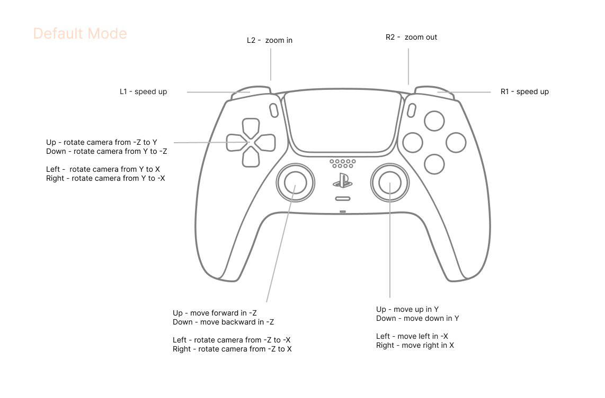
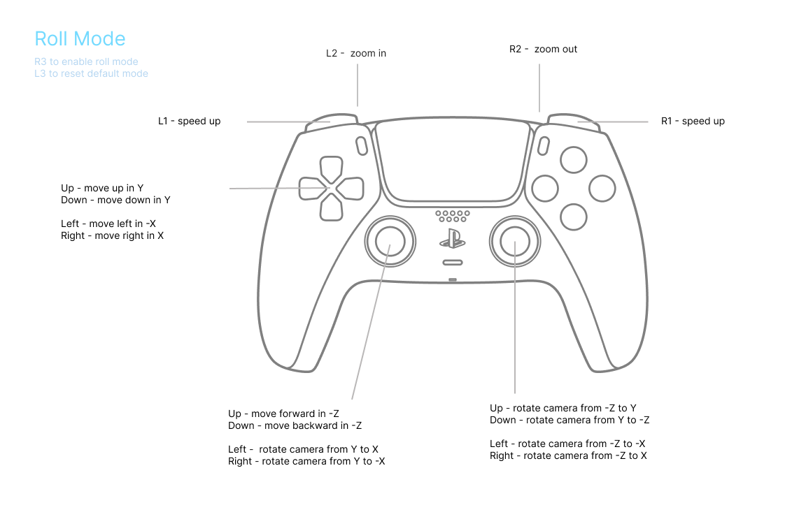

### Protea

> Compute boids with Triadica controls in WebGPU

Previews on https://webgpu.art/protea/

Based on https://webgpu.github.io/webgpu-samples/samples/computeBoids .

Search parameters:

- `remote-control` to enable remote control,
- `control-host` to set remote control host,
- `control-port` to set remote control port.

To use Protea, try [Protea TypeScript workflow](https://github.com/Triadica/protea-ts-workflow).

### Calcit demo development

使用者影响：Calcit Demo 使用正式 CLI 和 `@calcit/procs` **0.41.1**，本地升级后需重装依赖并刷新页面。模型切换、Reel 开发面板、远程控制的启用条件和 TypeScript 库 API 保持原行为。

Demo 配对 HUD Nav 0.0.11、Respo 0.19.5、UI 0.15.2 和 Reel 0.11.0。渲染事件使用
`ViewOp` union 区分应用操作和 HUD Nav 操作，Reel 面板与快捷键通过独立的
`Control` 回调处理。应用状态只保存所选模型，Reel 面板不写入应用状态。编译和 shader 错误继续通过
`hud!` 在页面显示。正常刷新回到原默认模型。

```sh
caps --strict --ci
corepack yarn install --immutable
caps verify --toolchain
calcit --check-only --all-defs
calcit fix --workflow strict --verify
corepack yarn build
corepack yarn compile
```

`compile` 是原 TypeScript 声明构建；开发时先用 `calcit calcit.cirru js` 生成 Demo，
再运行 `yarn vite`，持续编辑可另开终端运行 `calcit calcit.cirru -w`。
源码仅用 `calcit.cirru`、`deps.cirru`；生成的 js-out/dist/lib 不提交。
新解析候选 npm 版本采用 60 分钟包龄，无单包例外；正常复用 lock 不重新等待。

Actions 在 PR 检查并构建前端。main 上传 `dist/assets` 到原 COS 前缀并使用
Action 内置校验。npm release 工作流和前端部署路径保持原配置。

TypeScript 侧继续使用 `@triadica/touch-control@0.0.4-a1` 的渲染、状态、Atom
和向量 API。该 npm 包和 Calcit 模块分别发布。

### API

Main API of Protea is a function to pass buffers and shaders:

```ts
async function createRenderer(
  canvas: HTMLCanvasElement,
  computeOptions: {
    seedSize: number;
    seedData: Float32Array;
    params: number[];
    computeShader: string;
  },
  renderOptions: {
    vertexCount: number;
    vertexData: number[];
    vertexBufferLayout: GPUVertexBufferLayout[];
    indexData?: number[];
    renderShader: string;
  }
): RenderFn;
```

There are two phases running Protea demos:

- Compute shader to iterate ping/pong buffers, which hold information about points,
- Render shader to illustrate position and velocity of points.

The pipelines are reused, while parameters can be passed from main function.

This project is still in early stage and I used it for drawing interesting patterns.

### Shaders

- `#import protea::perspective` to import uniform and perspective function.
- `#import protea::colors` to import `hsl` function for intuitive color definition.

### Replace Parameters

To hot replace spin speed:

```js
window.__hotUpdateParams([0.1, 1.6, 0.12, 0.7]);
```

4 paramters are:

- `speed`
- `length` of stroke
- `width` of stroke
- `opacity`

### Bind Groups

Bindings in shader:

```wgsl
@group(0) @binding(0) var<uniform> uniforms: UniformData;
@group(0) @binding(1) var<uniform> params: Params;

@group(1) @binding(0) var<storage, read> particles_a: Particles;
@group(1) @binding(1) var<storage, read_write> particles_b: Particles;
```

shaders is mocked to be unified in both compute shader and fragment shader.

### Gamepad Manual



"Roll mode" means to earier to roll the camera,



### Licence

MIT
