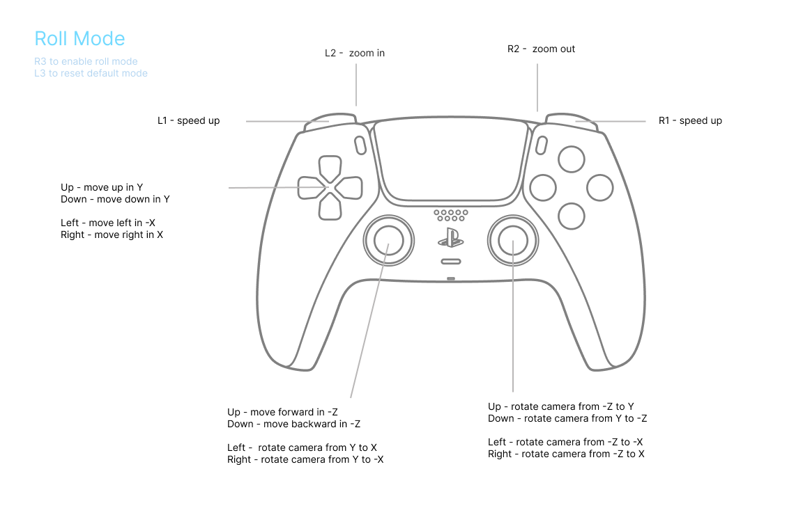

### Protea

> Compute boids with Triadica controls in WebGPU

Previews on https://webgpu.art/protea/

Based on https://webgpu.github.io/webgpu-samples/samples/computeBoids .

Search parameters:

- `remote-control` to enable remote control,
- `control-host` to set remote control host,
- `control-port` to set remote control port.

To use Protea, try [Protea TypeScript workflow](https://github.com/Triadica/protea-ts-workflow).

### Calcit demo development

使用者影响：Demo 迁移到正式 Calcit CLI / `@calcit/procs` 0.31.0，使用 Node 24 和 Yarn 4.18.0。
模块配对已发布 HUD Nav 0.0.9、Respo 0.17.0-alpha.4、UI 0.9.0-alpha.4、Reel 0.7.0-alpha.4。
TypeScript 库 API、npm 版本和原发布工作流不变，本次不发布 npm。

renderer 的真实事件入口沿用 Enum，回调先检查 `enum?` 再派发，非法非 Enum 更早拒绝。
现有 Store/updater 的字段解码、渲染器函数检查、remote-control 显式启用方式保持。
`hud!` 成功/错误提示保留；reload 末尾明确返回 Unit，避免用 JS 提示函数的未知返回值冒充 Unit。
匿名 Enum 槽与具体函数的证明限制跟踪 [Calcit #2447](https://github.com/calcit-lang/calcit/issues/2447)，
这里不扩大为 Dynamic，不使用 unsafe 或关闭检查。

`calcit.cirru` is the canonical source; dependencies are pinned in `deps.cirru`.
Run `caps --strict --ci`, `yarn install --immutable`, then `yarn build`.

The application Store has a required Tag `tab` and an explicitly open Respo
component-state tree. HUD events enter as Enum values; payloads are decoded at
the updater boundary. JavaScript renderers retain their opaque host identity,
are checked as functions on load, and are called with Number/Bool arguments.

Actions checks all definitions and the complete strict workflow, and rejects deprecated calls and unresolved
dynamic methods. Only main uploads `dist/assets` to
`https://cos-sh.tiye.me/WebGPU-Art/protea/assets/`; the COS action performs its
own checksum verification before the original page deployment runs. The page
path and TypeScript library's npm release workflow are unchanged.

### API

Main API of Protea is a function to pass buffers and shaders:

```ts
async function createRenderer(
  canvas: HTMLCanvasElement,
  computeOptions: {
    seedSize: number;
    seedData: Float32Array;
    params: number[];
    computeShader: string;
  },
  renderOptions: {
    vertexCount: number;
    vertexData: number[];
    vertexBufferLayout: GPUVertexBufferLayout[];
    indexData?: number[];
    renderShader: string;
  }
): RenderFn;
```

There are two phases running Protea demos:

- Compute shader to iterate ping/pong buffers, which hold information about points,
- Render shader to illustrate position and velocity of points.

The pipelines are reused, while parameters can be passed from main function.

This project is still in early stage and I used it for drawing interesting patterns.

### Shaders

- `#import protea::perspective` to import uniform and perspective function.
- `#import protea::colors` to import `hsl` function for intuitive color definition.

### Replace Parameters

To hot replace spin speed:

```js
window.__hotUpdateParams([0.1, 1.6, 0.12, 0.7]);
```

4 paramters are:

- `speed`
- `length` of stroke
- `width` of stroke
- `opacity`

### Bind Groups

Bindings in shader:

```wgsl
@group(0) @binding(0) var<uniform> uniforms: UniformData;
@group(0) @binding(1) var<uniform> params: Params;

@group(1) @binding(0) var<storage, read> particles_a: Particles;
@group(1) @binding(1) var<storage, read_write> particles_b: Particles;
```

shaders is mocked to be unified in both compute shader and fragment shader.

### Gamepad Manual


"Roll mode" means to earier to roll the camera,



### Licence

MIT
